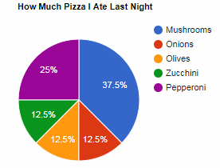

The Google Charts project allows creation of charts using the [Google Charts](https://developers.google.com/chart/) Loader API.

The API does not try to hide the Google API, instead it gives just a way to build the charts in Java programming language as close as possible to the Google API and integrate it with Apache Wicket. So please read the documentation of the original API, if you are not familiar with Google charts.

## Maven

```xml
<dependency>
    <groupId>org.wicketstuff</groupId>
    <artifactId>wicket-gchart</artifactId>
</dependency>
```

Import `org.wicketstuff:wicketstuff-bom` in your `dependencyManagement` section to manage the version.

## Example

The following example code reproduces the pie chart of the [Quick Start](https://developers.google.com/chart/interactive/docs/quick_start).

Java:

```java
IModel<ChartOptions> optionsModel = new IModel<ChartOptions>() {
    private static final long serialVersionUID = 1L;

    @Override
    public ChartOptions getObject() {
        ChartOptions opts = new ChartOptions("options");
        opts.put("title", "How Much Pizza I Ate Last Night");
        return opts;
    }
};

IModel<DataTable> dataModel = new IModel<DataTable>() {
    private static final long serialVersionUID = 1L;

    @Override
    public DataTable getObject() {
        List<ColumnDeclaration> colDefs;
        List<DataRow> rows;
        colDefs = new ArrayList<>(2);
        colDefs.add(new ColumnDeclaration(ColumnType.STRING, "Topping"));
        colDefs.add(new ColumnDeclaration(ColumnType.NUMBER, "Slices"));

        rows = new ArrayList<>(5);
        rows.add(new DataRow(Arrays.asList(new Object[]{"Mushrooms", 3})));
        rows.add(new DataRow(Arrays.asList(new Object[]{"Onions", 1})));
        rows.add(new DataRow(Arrays.asList(new Object[]{"Olives", 1})));
        rows.add(new DataRow(Arrays.asList(new Object[]{"Zucchini", 1})));
        rows.add(new DataRow(Arrays.asList(new Object[]{"Pepperoni", 2})));
        return new DataTable("data", colDefs, rows);
    }
};

add(new Chart("chartPie", Model.of(ChartType.PIE), optionsModel, dataModel));
```

HTML:

```html
<div class="gchart" wicket:id="chartPie"></div>
```

Result:



## Project maintainers

Dieter Tremel

The [`gchart-examples`](https://github.com/wicketstuff/core/tree/master/gchart-parent/gchart-examples) module contains a runnable example application.

Source: [`gchart-parent`](https://github.com/wicketstuff/core/tree/master/gchart-parent)
