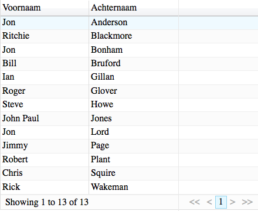

A data grid component with the following features:

* Fully Ajaxified
* Editable cells
* Pageable
* OSGi-ready

Here is how it might look:



A possible alternative to this component are the Wicket Stuff DataTables and Editable Grid components.

## Maven

```xml
<dependency>
    <groupId>org.wicketstuff</groupId>
    <artifactId>wicketstuff-inmethod-grid</artifactId>
</dependency>
```

Import `org.wicketstuff:wicketstuff-bom` in your `dependencyManagement` section to manage the version.

## Usage

Java:

```java
final List<Person> personList = ... ;
final ListDataProvider<Person> listDataProvider = new ListDataProvider<>(personList);

List<IGridColumn> cols = (List) Arrays.asList(
    new PropertyColumn(new Model("First Name"), "firstName"),
    new PropertyColumn(new Model("Last Name"), "lastName"));
DataGrid grid = new DefaultDataGrid("grid", new DataProviderAdapter(listDataProvider), cols);
add(grid);
```

HTML:

```html
<div wicket:id="grid"></div>
```

## Project maintainers

Matej Knopp

The [`inmethod-grid-examples`](https://github.com/wicketstuff/core/tree/master/inmethod-grid-parent/inmethod-grid-examples) module contains a runnable example application.

Source: [`inmethod-grid-parent`](https://github.com/wicketstuff/core/tree/master/inmethod-grid-parent)
