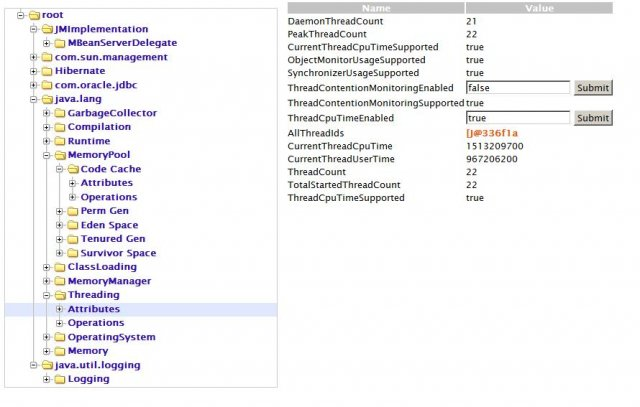

JMX panel, to view and operate the application's MBeans.



This JMX panel tries to access the platform MBeanServer by invoking `ManagementFactory#getPlatformMBeanServer` and present its structure using a tree component, and its managed beans in property panels.

## Maven

```xml
<dependency>
    <groupId>org.wicketstuff</groupId>
    <artifactId>wicketstuff-mbeanview</artifactId>
</dependency>
```

Import `org.wicketstuff:wicketstuff-bom` in your `dependencyManagement` section to manage the version.

## Java

```java
add(new MBeansPanel("example"));
```

## HTML

```html
<div wicket:id="example"></div>
```

## Project maintainers

Pedro Santos, pedrosans@gmail.com

The [`mbeanview-examples`](https://github.com/wicketstuff/core/tree/wicket-11.x/mbeanview-parent/mbeanview-examples) module contains a runnable example application.

Source: [`mbeanview-parent`](https://github.com/wicketstuff/core/tree/wicket-11.x/mbeanview-parent)
