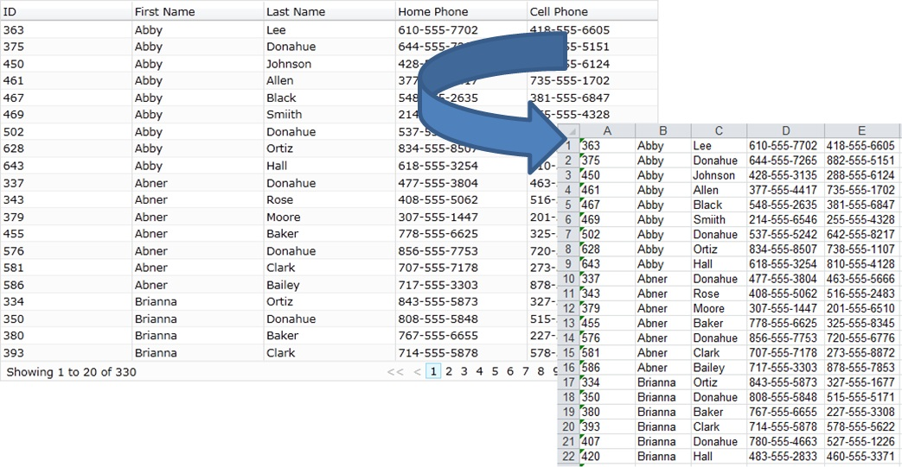

Misc types to integrate Wicket projects with Apache POI. The project has a handler able to respond with an XLS file to a request, based on the rendered table and its data components.



## Maven

```xml
<dependency>
    <groupId>org.wicketstuff</groupId>
    <artifactId>wicketstuff-poi</artifactId>
</dependency>
```

Import `org.wicketstuff:wicketstuff-bom` in your `dependencyManagement` section to manage the version.

## Documentation

In Wicket projects we end up creating several types of components for the same purpose: generate an HTML table component. This project aims to provide integration components to generate a POI Workbook for those. In order to understand the table structure `TableComponentAsXlsHandler` will parse the generated markup while trying to maintain a link between markup and Wicket components in table data. Even if the component only generates the table markup, `TableComponentAsXlsHandler` will still be able to generate a Workbook because it will use the parsed content.

### TableComponentAsXlsHandler

Request handler that responds with the specified table component as an XLS file. It uses a `CellExporter` to delegate the task of resolving and setting the table data in the POI Cell component.

#### Pagination friendly

If the Wicket table component implements the `IPageable` interface, `TableComponentAsXlsHandler` will visit every page in order to generate the table content.

### GeneralPurposeExporter

A general purpose `CellExporter` that parses the table HTML looking for the first most nested tag. If this tag has a correspondent Wicket component, set its model value respecting its type in the POI Cell. If the counterpart Wicket component can not be resolved, set the tag text component. This is the default `CellExporter` set in `TableComponentAsXlsHandler`.

### XlsStream

XLS file stream for a POI Workbook. It can be used to create a Wicket resource.

## Java

```java
add(new Link<Void>("exportToXLS")
{
	@Override
	public void onClick()
	{
		Component tableComponent; //any Wicket component generating HTML table tag and its inner markup
		IRequestHandler handler = new TableComponentAsXlsHandler(tableComponent);
		RequestCycle.get().scheduleRequestHandlerAfterCurrent(handler);
	}
});
```

## HTML

```html
<a wicket:id="exportToXLS">Export to XLS</a>
```

## Project maintainers

Pedro Santos - pedrosans@gmail.com

The [`wicket-poi-examples`](https://github.com/wicketstuff/core/tree/master/wicket-poi-parent/wicket-poi-examples) module contains a runnable example application.

Source: [`wicket-poi-parent`](https://github.com/wicketstuff/core/tree/master/wicket-poi-parent)
